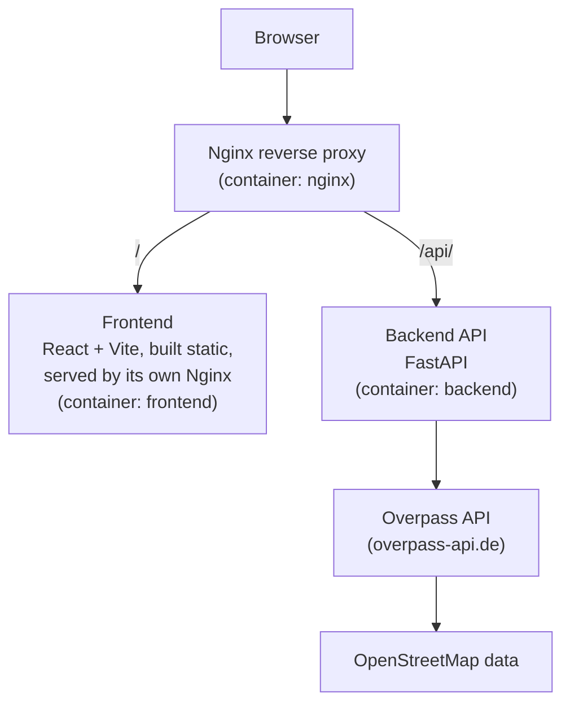
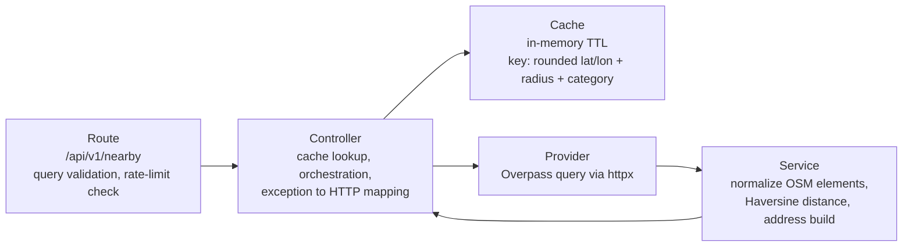

# KnowWhere Architecture

Component and request-flow diagram, derived from `compose.yaml`, `nginx/nginx.conf`, and the backend source tree (`backend/src/routes`, `controllers`, `cache`, `services`, `providers`).

## Backend request flow

Notes:
- Both diagrams are Mermaid source only — no local Mermaid renderer (`mmdc`) was available in this session, so no PNG/SVG was generated.
- Cache and rate limiter are both in-process Python dicts (`backend/src/cache/memory.py`, `backend/src/middleware/rate_limit.py`) — no Redis or external store involved.
