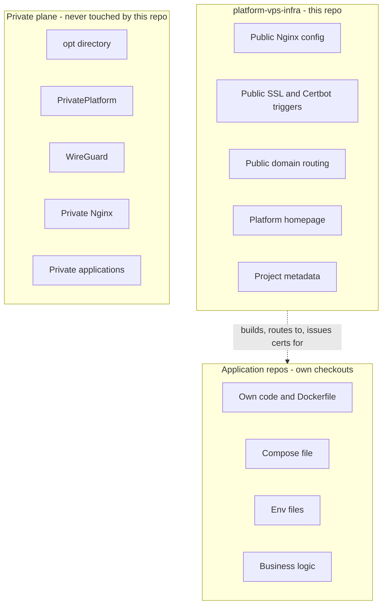
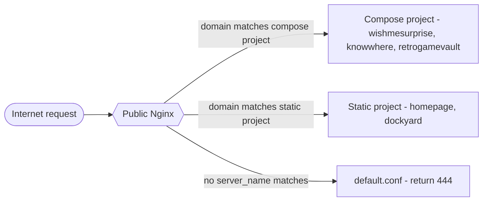
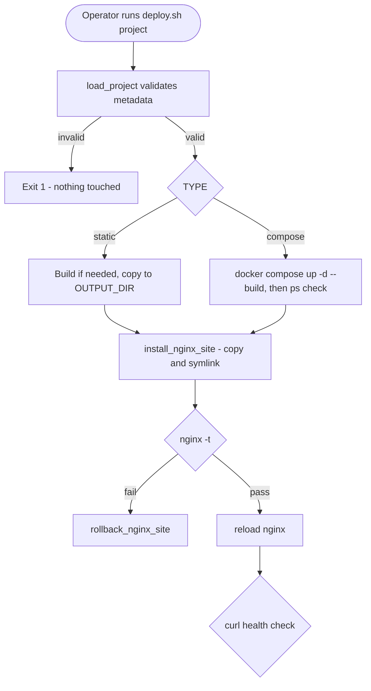
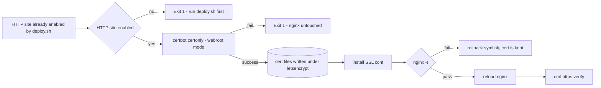

# Architecture Diagrams

Mermaid source, verified against the live repo's scripts and Nginx configs (see
`../docs/ARCHITECTURE.md` for the full narrative). No renderer was available in
this environment — these are source diagrams; paste into any Mermaid-compatible
viewer (GitHub renders `.md` Mermaid blocks natively) or run `mmdc` to export
PNG/SVG.

## System ownership boundary

## Request flow

## Deployment flow (`deploy.sh`)

## SSL issuance flow (`ssl.sh`)

