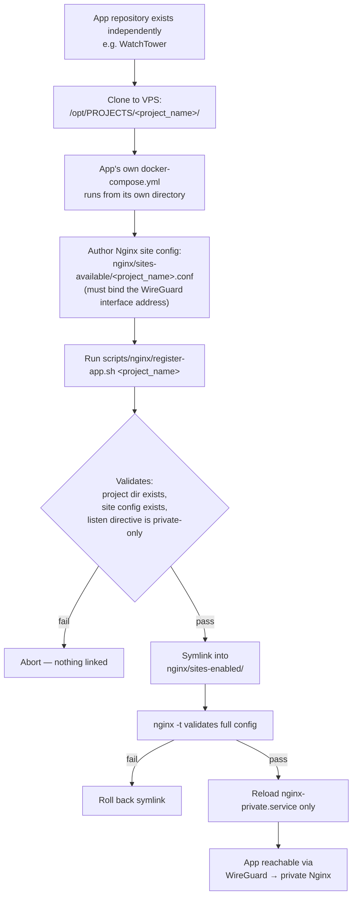

# Application Onboarding Workflow

How a new private application joins the platform, per the convention confirmed across `specs/001` and `specs/006` and implemented by `scripts/nginx/register-app.sh`. Demonstrated once in practice (WatchTower, plus Grafana as a sub-service registered under WatchTower's project).

**Status:** this exact flow has been run for two real site registrations (`watchtower.conf`, `grafana.conf`) — the script and its validation guard are implemented and exercised, not just designed. What remains unverified in this session: there is no automated test suite confirming the rollback path (`F -- fail`, `I -- fail`) actually triggers correctly; that logic is present in the script but not independently proven here.
