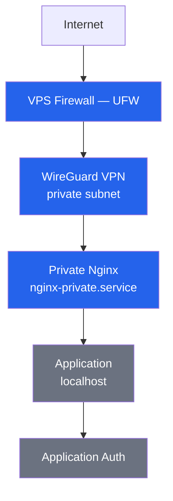
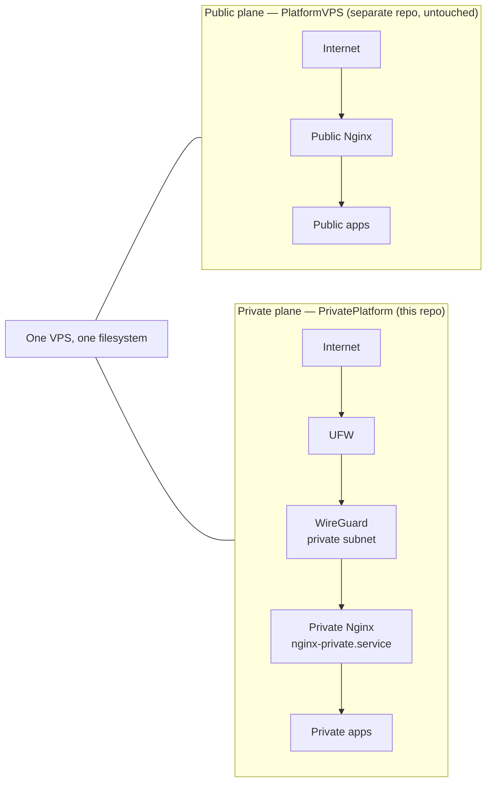

# Request Path — Implemented vs Planned

Layered access chain for a private application, as confirmed in `specs/002`, `specs/003`, and implemented by `scripts/setup/*`. Each layer is independent — none substitutes for another (explicit project rule).

**Legend:** blue = implemented and scripted (UFW rule, WireGuard interface, private Nginx instance). Gray = owned by each application's own repository, outside this platform's scope — shown for completeness, not claimed as built here.

## Side-by-side with the public plane

The private plane never shares a process, config file, or listener with the existing public plane (`PlatformVPS`, under `/srv/`). This separation is a hard constraint, not an implementation detail.

One VPS, two independent planes. The private plane's Nginx binds only the WireGuard interface — `scripts/nginx/register-app.sh` hard-rejects any site config that binds `0.0.0.0` or a bare port, to prevent an app leaking onto the public interface by mistake.
