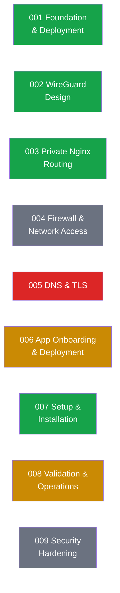

# Spec-to-Implementation Status

Nine numbered specs under `specs/001`–`specs/009` drive this project. Each spec states what's CONFIRMED, PROPOSED, or OPEN; specs get amended with RESOLVED notes once real implementation settles a question — the specs are a living record of the design loop, not a one-time plan.

**Legend**
- 🟢 **Implemented & exercised** — 001 (directory layout + `/opt/PROJECTS/` convention), 002 (WireGuard hub, peer enrollment script), 003 (private Nginx instance, `register-app.sh`), 007 (full `setup.sh` pipeline).
- 🟡 **Partially implemented** — 006 (onboarding process works in practice via `register-app.sh`, but `deployments/<app>/` artifact format is still an open spec item); 008 (several checks already covered by `scripts/setup/05-validate.sh`, but not all of the spec's checklist is automated).
- ⚪ **Design only, principles confirmed** — 004 (firewall posture agreed, enforcement mechanism beyond the one UFW rule not yet built), 009 (security-hardening gaps identified, no implementation started).
- 🔴 **Explicitly open** — 005 (DNS/TLS: base domain resolved, but certificate strategy for private domains is an unresolved decision; current sites serve plain HTTP over the WireGuard tunnel).

This is intentional spec-driven sequencing, not stalled work — see `docs/DESIGN_DECISIONS.md` for why TLS and firewall-level app isolation were deliberately deferred rather than guessed at.
