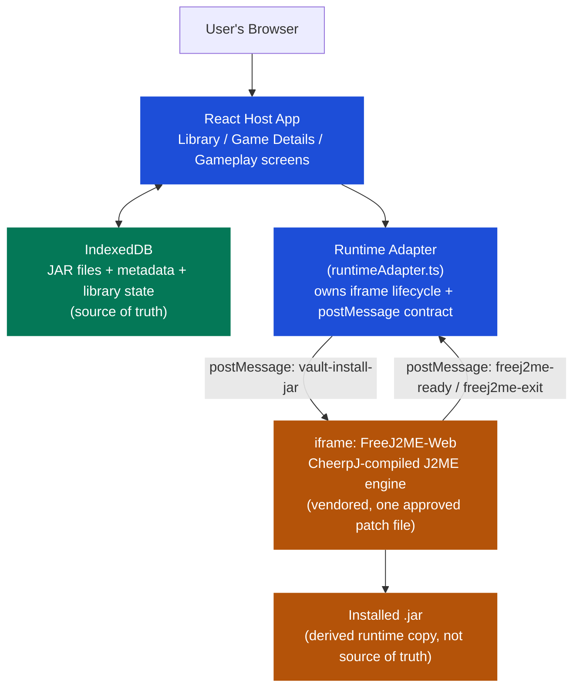

# Architecture

Editable Mermaid source. Renders automatically on GitHub and most Markdown viewers.

## Notes

- The host app and the vendored engine communicate **only** through the `postMessage` contract shown above — this is the entire integration surface, per the project's `app/`↔`engine/` boundary rule.
- IndexedDB is the single source of truth for which games exist and their metadata. The engine's own installed JAR (inside its virtual filesystem) is always a disposable, re-created-per-session copy.
- No in-place game switching: a new Gameplay session always destroys the previous iframe and creates a fresh one.
