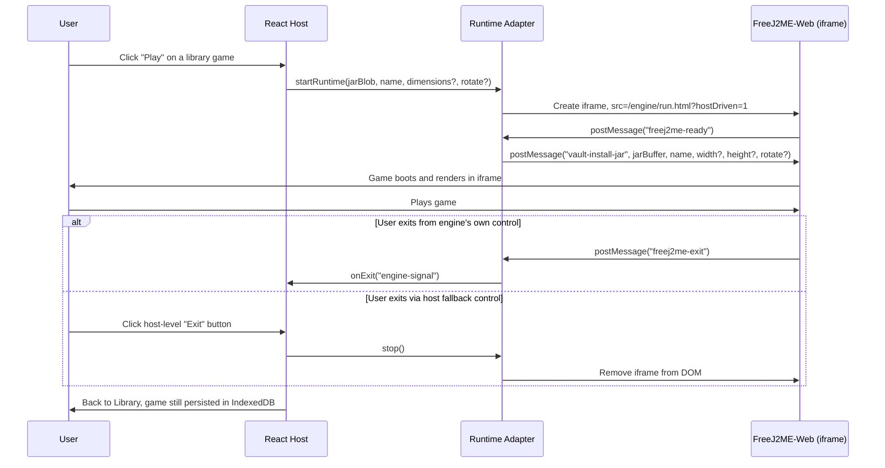

# Gameplay Session Sequence

Editable Mermaid source, based directly on `app/src/runtimeAdapter.ts`'s message handling.

## Why dual-signaled exit matters

The engine can tell the host it exited (`freej2me-exit`), but the host never depends on that message alone — a host-level Exit control works independently of engine cooperation. If the engine hangs or never fires the message, the user is never stuck inside a game with no way out.
