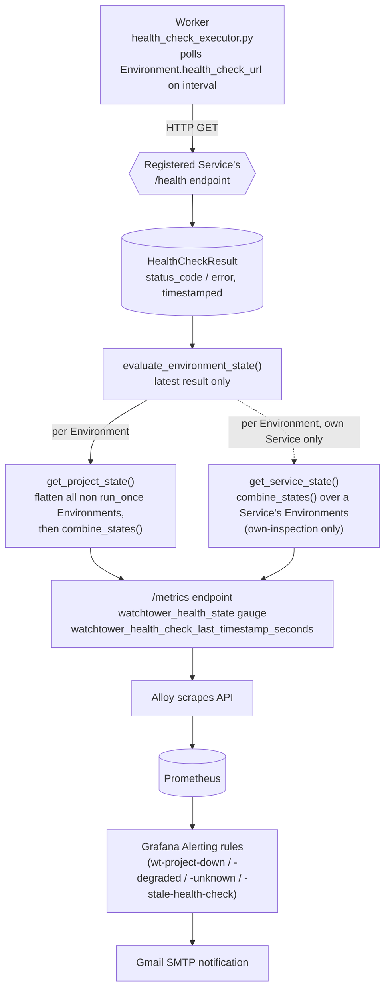

# Health Evaluation & Alerting Flow

How a raw `/health` poll becomes a `HealthState`, rolls up to Project level, gets exported as a metric, and can fire a Grafana alert. This is WatchTower's own operational-intelligence layer — the part the project deliberately does not delegate to Prometheus/Grafana.



## Rollup rule (as implemented, `src/watchtower/registry/health.py`)

```text
Environment state  = f(latest HealthCheckResult only — no history window)
                      2xx           -> HEALTHY
                      non-2xx/error -> DOWN
                      no URL / no result yet -> UNKNOWN

Project state       = combine_states(
                         flatten of all non-run_once child Services' Environment states
                       )
                       all HEALTHY           -> HEALTHY
                       all DOWN              -> DOWN
                       some (not all) DOWN   -> DEGRADED
                       no DOWN, some UNKNOWN -> UNKNOWN
```

Key design point (see [`../docs/DESIGN_DECISIONS.md`](../docs/DESIGN_DECISIONS.md#single-stage-flatten-not-two-stage-combine)): Project rollup flattens directly over Environments rather than pre-combining each Service into one value first — a two-stage combine would have silently invented a Service-level aggregation rule not present in the spec. `run_once` Services (e.g. bootstrap/init containers) are excluded entirely from rollup since their exit is not a failure signal.

Dependency edges (`Service` → `Service`) are recorded in the registry but are **not** consulted by this rollup — dependency-based attribution ("API is unhealthy *because* Redis is down") remains an open question, tracked in `specs/operational-model.md`.
