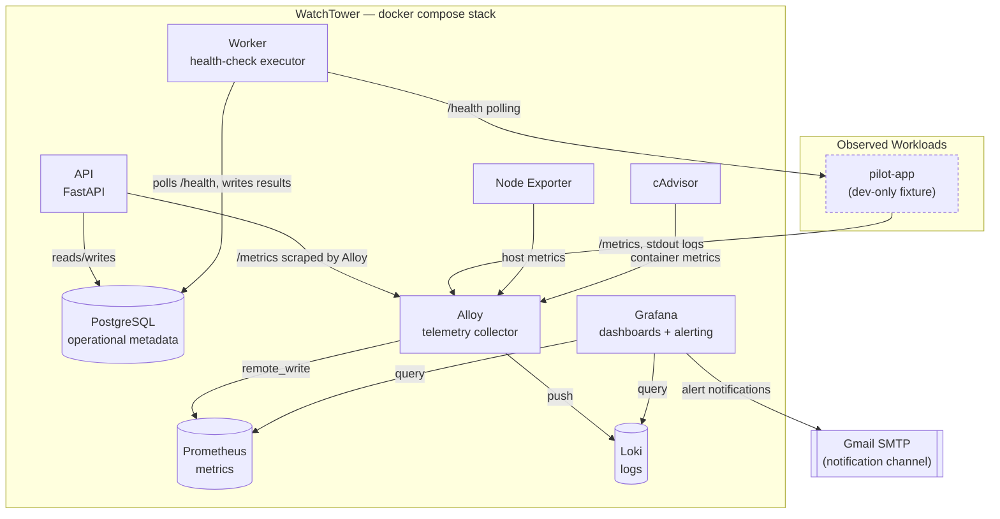

# System Architecture

Component layout as implemented in `docker-compose.yml` and `deploy/`. All services share one Docker network (`watchtower-internal`); only Grafana is published to the host (loopback-only, for the upstream reverse proxy).

## Notes

- **Control/API layer** (`api`, `worker`, `postgres`) is WatchTower's own code — the operational model (Projects/Services/Environments/Dependencies, health rollup) lives here, not in Prometheus/Grafana.
- **Telemetry layer** (`prometheus`, `loki`, `grafana`, `alloy`, `node-exporter`, `cadvisor`) is intentionally off-the-shelf — per the project's stated philosophy, WatchTower does not reimplement metrics/log storage or visualization.
- `pilot-app` is a dev-only fixture (Docker Compose `dev` profile) used to prove the application observability contract end to end; it is not a production dependency.
- Grafana is the only service with a published host port, bound to loopback only and reserved for the private platform's reverse proxy. Every other service is reachable only on the internal Docker network — see [`../docs/DESIGN_DECISIONS.md`](../docs/DESIGN_DECISIONS.md#network-hardening).
