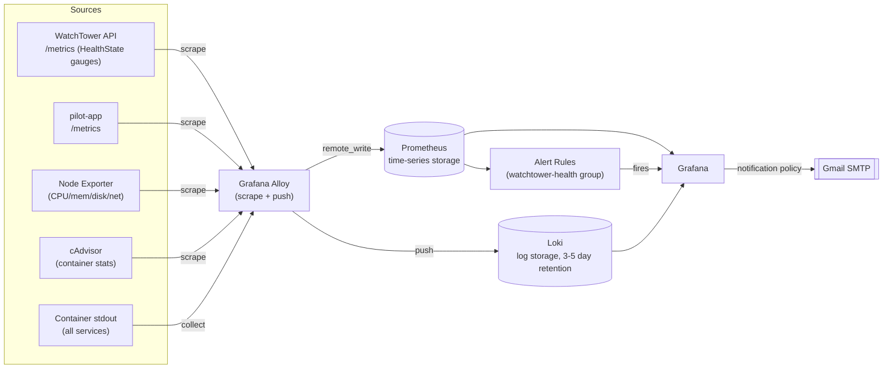

# Telemetry Flow (Metrics & Logs)

How a metric or log line gets from a workload to a Grafana dashboard or alert. Traces are not implemented in this phase (project plan Phase 6, not yet started).

## What actually flows today

| Signal | Producer | Path | Consumer |
|---|---|---|---|
| Infra metrics (CPU/mem/disk/net) | Node Exporter | Alloy → Prometheus | Infrastructure dashboard, 3 alert rules |
| Container metrics | cAdvisor | Alloy → Prometheus | Infrastructure dashboard (container panels — see caveat below) |
| `watchtower_health_state` gauge | WatchTower API `/metrics` | Alloy scrape → Prometheus | 3 alert rules (project down/degraded/unknown) |
| `watchtower_health_check_last_timestamp_seconds` gauge | WatchTower API `/metrics` | Alloy scrape → Prometheus | Staleness alert rule |
| pilot-app request counter | pilot-app `/metrics` | Alloy scrape → Prometheus | Application dashboard, scrape-liveness alert |
| Container/application logs | stdout | Alloy → Loki | Log panels in both dashboards |

**Known environment caveat**: cAdvisor cannot resolve per-container stats on Docker Desktop (Windows/Mac) because its engine uses containerd snapshotters rather than the classic dockerd overlayfs layout cAdvisor expects. Host-level cgroup metrics still work; real per-container CPU/memory/restart data is expected to resolve on a native Linux Docker host (the target VPS). Documented in `docker-compose.yml`'s `cadvisor` service comment.
